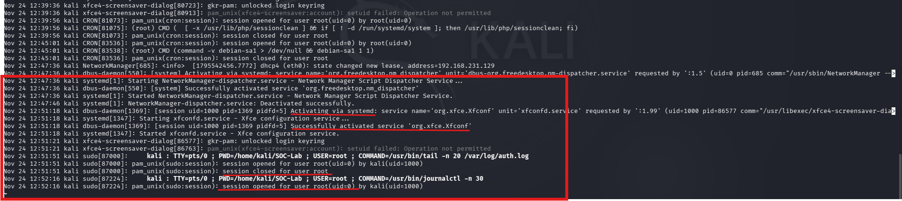
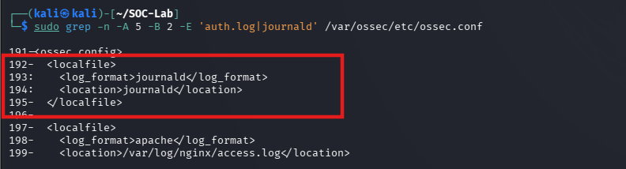
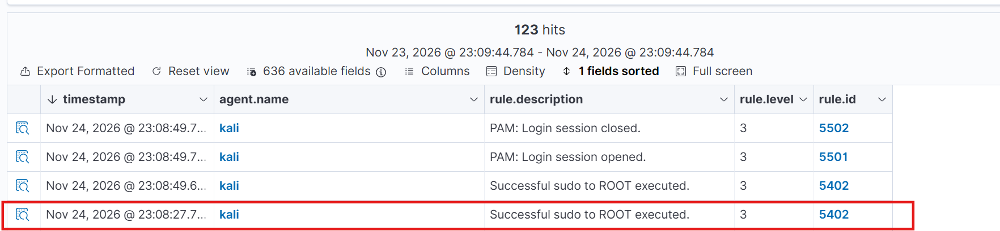
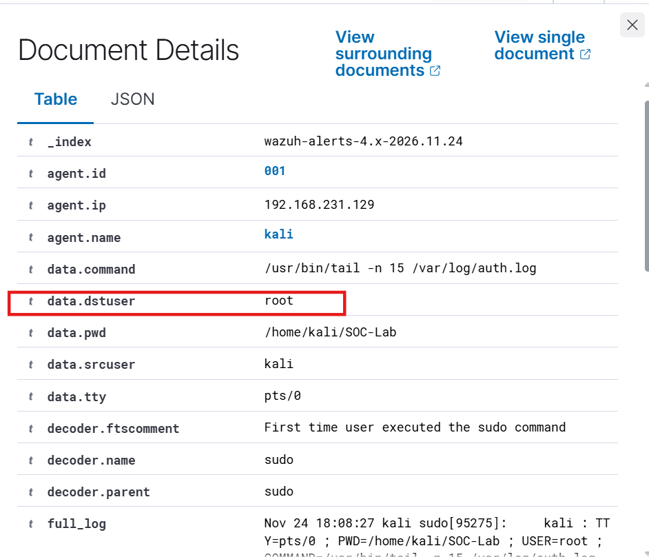
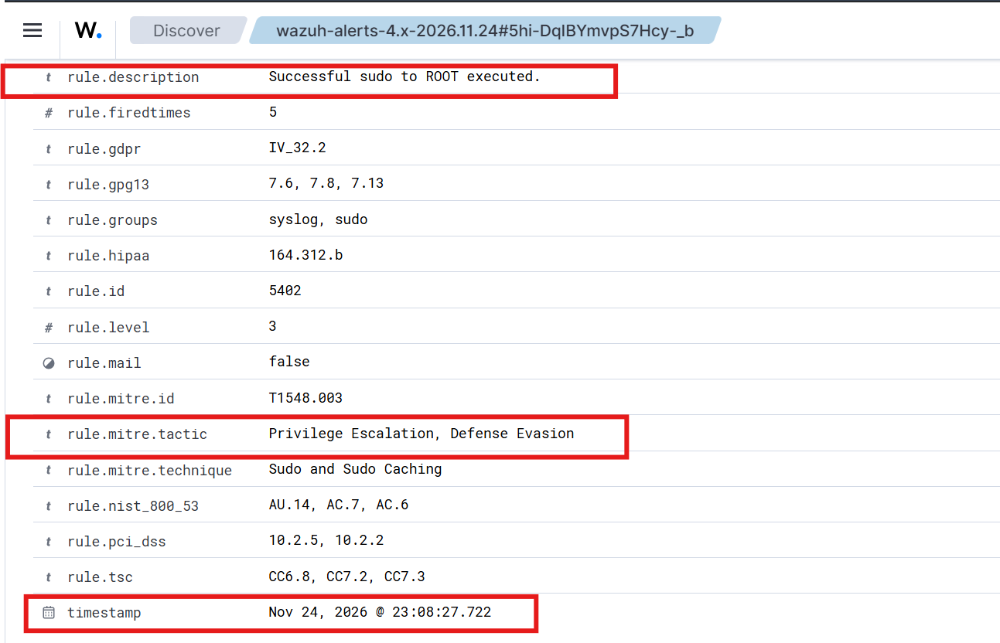
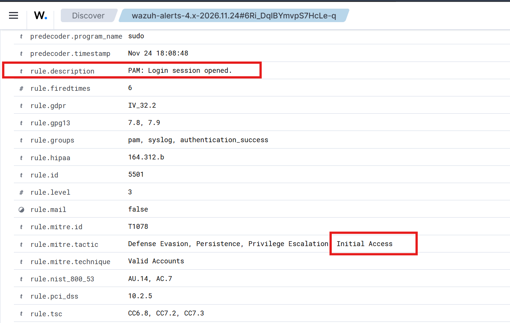
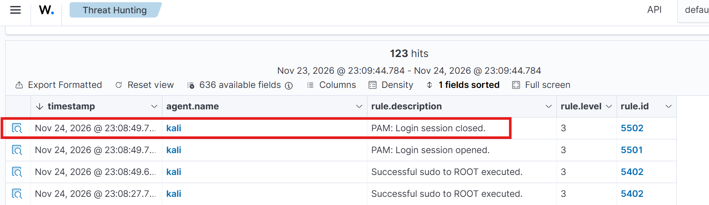

# SOC Investigation Report 02
## Linux Authentication Log Investigation

## 1. Investigation Overview
- SIEM: Wazuh 4.14.10
- Endpoint: Kali Linux 2026.2
- Agent ID: 001
- Operating system: Kali GNU/Linux

## 2. Objective
To examine Linux authentication logs and determine whether Wazuh collects and detects authentication-related activity.

## 3. Activities Performed
1. Inspected Linux authentication logs (`sudo tail` on `/var/log/auth.log` and `journalctl`).
2. Confirmed which log sources the Wazuh agent collects (`journald` in `ossec.conf`).
3. Generated successful sudo authentication events.
4. Reviewed the events in the Wazuh dashboard.

> A controlled **failed** sudo attempt was not captured in the evidence for this investigation, so it is recorded as not observed below rather than assumed.

## 4. Findings

| Activity | Raw log found? | Wazuh alert found? |
|---|---|---|
| Failed authentication | Not tested / not observed | Not tested / not observed |
| Successful authentication (sudo to root) | Yes | Yes (rule 5402) |

Related Wazuh alerts observed:

| Rule ID | Description | Level |
|---|---|---|
| 5402 | Successful sudo to ROOT executed. | 3 |
| 5501 | PAM: Login session opened. | 3 |
| 5502 | PAM: Login session closed. | 3 |

## 5. Analysis
**Raw logs.** The log extract (`screenshots/auth-raw-log.png`, VM clock Nov 24 12:51-12:52) shows user `kali` running sudo from `TTY=pts/0`, `PWD=/home/kali/SOC-Lab`, `USER=root`, with commands such as `/usr/bin/tail -n 20 /var/log/auth.log` and `/usr/bin/journalctl -n 30`. Each is followed by `pam_unix(sudo:session): session opened for user root(uid=0) by kali(uid=1000)` and a session-closed entry.

**Log collection.** `ossec.conf` contains a `<localfile>` entry with `log_format` and `location` both set to `journald`, which is how the agent receives these authentication events.

**Wazuh alerts.** A later run (alert time Nov 24, 2026 @ 23:08:27, dashboard time UTC+5; the raw `full_log` shows 18:08:27, i.e. the same moment in the VM's UTC clock) produced:
- Rule 5402, "Successful sudo to ROOT executed", level 3. Fields: `data.srcuser` = kali, `data.dstuser` = root, `data.tty` = pts/0, `data.pwd` = /home/kali/SOC-Lab, `data.command` = `/usr/bin/tail -n 15 /var/log/auth.log`, decoder `sudo`. The decoder comment "First time user executed the sudo command" is a first-seen indicator.
- MITRE ATT&CK mapping for 5402: T1548.003 (Sudo and Sudo Caching), tactics Privilege Escalation and Defense Evasion.
- Rules 5501 and 5502 (PAM session opened/closed), mapped to T1078 (Valid Accounts) with tactics including Initial Access, Persistence, Privilege Escalation and Defense Evasion. Both are level 3 (informational).

Note: the raw-log extract and the Wazuh alerts come from two separate test runs on the same day (different commands and times), so they are corroborating examples of the same behavior rather than the same individual events.

## 6. Classification
Benign authorized testing. All sudo activity was initiated by the analyst on their own lab VM.

## 7. Conclusion
The investigation demonstrated that Wazuh collects Linux authentication activity through journald and raises alerts for successful sudo use and PAM session open/close, enriched with user, command, working directory, TTY and MITRE ATT&CK data.

Detection gap / limitation: failed authentication was not tested in this evidence set, so detection of failed sudo attempts is unverified. This should be repeated with one controlled wrong-password sudo attempt. Also, level 3 alerts are low severity and would normally be filtered or correlated in a production SOC.

## 8. Evidence
- Authentication log output: 
- Log collection config: 
- Wazuh security events: 
- Event details (user, command): 
- Rule information (5402, MITRE): 
- PAM session opened (5501): 
- PAM session closed (5502): 
