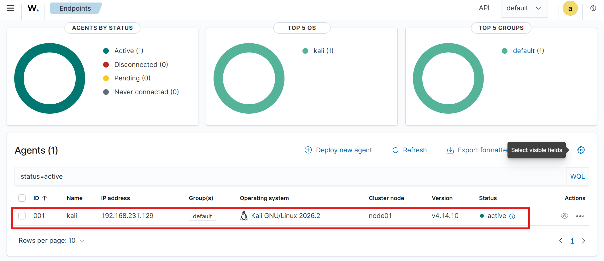
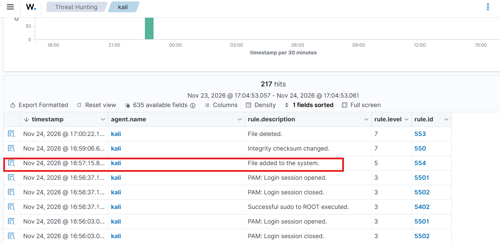
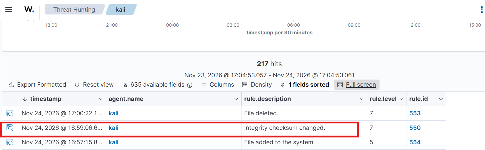
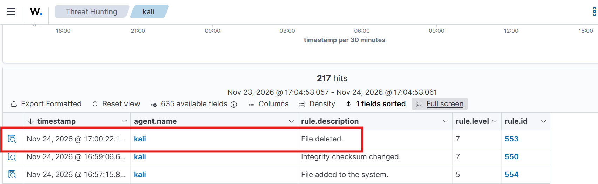
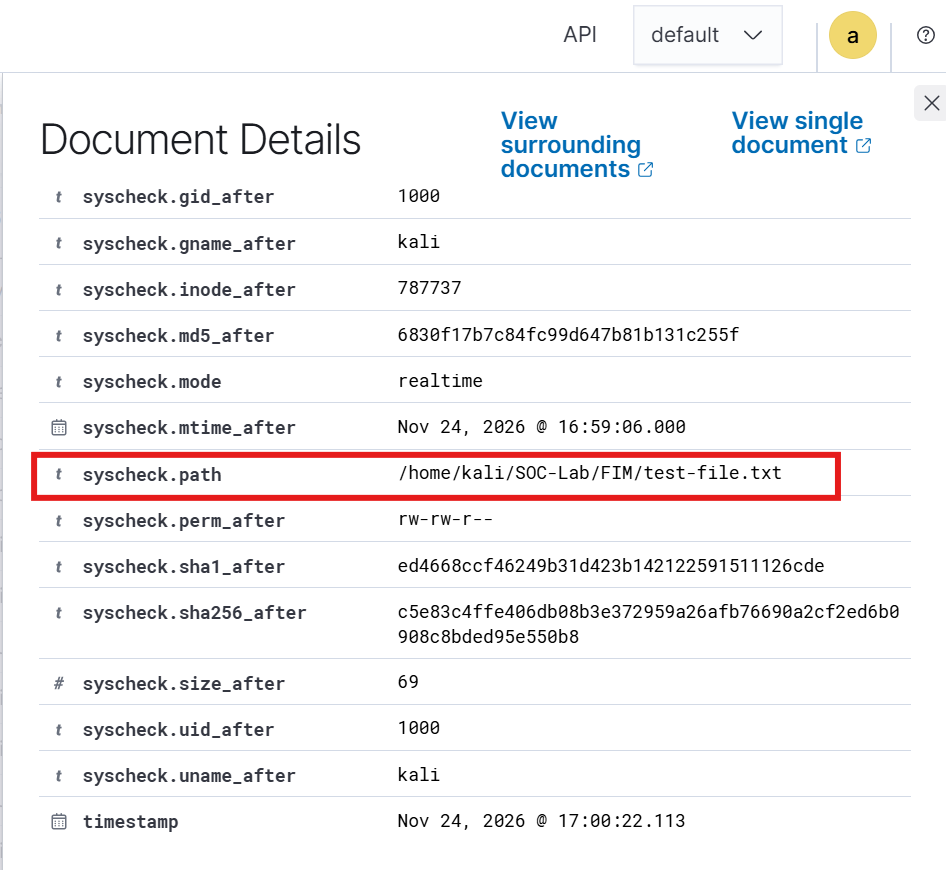
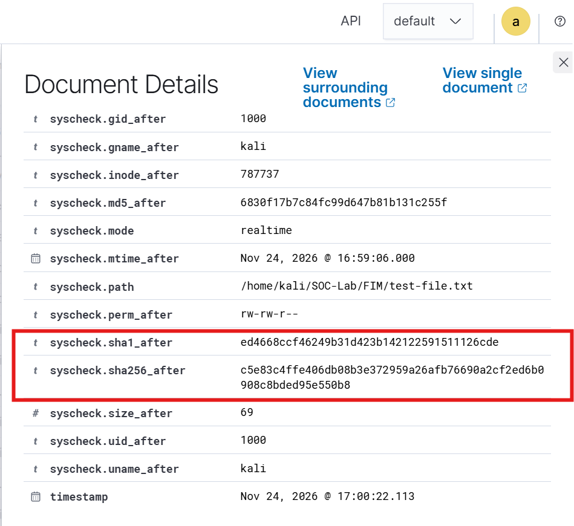

# SOC Investigation Report 01
## File Integrity Monitoring Investigation

## 1. Investigation Overview
- SIEM: Wazuh 4.14.10
- Endpoint: Kali Linux 2026.2
- Agent ID: 001
- Endpoint IP: 192.168.231.129
- Monitoring technology: File Integrity Monitoring (FIM)

## 2. Objective
To verify that Wazuh can detect file creation, modification, and deletion on a monitored Linux endpoint.

## 3. Environment
- Monitored directory: `/home/kali/SOC-Lab/FIM`
- Wazuh agent: Active (see `screenshots/wazuh-agent-active.png`)
- Real-time monitoring: Enabled (the alert records `syscheck.mode: realtime`)

## 4. Activities Performed
1. Created `test-file.txt` in the monitored directory (`echo "Initial SOC lab test" > ~/SOC-Lab/FIM/test-file.txt`).
2. Modified `test-file.txt` by appending a line (`echo "..." >> ~/SOC-Lab/FIM/test-file.txt`).
3. Deleted `test-file.txt` (`rm ~/SOC-Lab/FIM/test-file.txt`).

## 5. Findings

| Activity | Detected? | Rule ID | Rule description | Level | Timestamp (dashboard time, UTC+5) |
|---|---|---|---|---|---|
| File creation | Yes | 554 | File added to the system. | 5 | Nov 24, 2026 @ 16:57:15 |
| File modification | Yes | 550 | Integrity checksum changed. | 7 | Nov 24, 2026 @ 16:59:06 |
| File deletion | Yes | 553 | File deleted. | 7 | Nov 24, 2026 @ 17:00:22 |

## 6. Analysis
Wazuh generated one alert for each stage of the file lifecycle, in the expected order, on agent `kali` (ID 001). The deletion alert's document details show:

- `syscheck.path`: `/home/kali/SOC-Lab/FIM/test-file.txt`, which matches the monitored directory.
- `syscheck.mode`: `realtime`, which confirms real-time monitoring was active rather than waiting for a scheduled scan.
- Last-known file attributes: owner `kali` (uid/gid 1000), permissions `rw-rw-r--`, size 69 bytes, last modified 16:59:06.
- SHA-1 `ed4668ccf46249b31d423b142122591511126cde` and SHA-256 `c5e83c4ffe406db08b3e372959a26afb76690a2cf2ed6b0908c8bded95e550b8`, which can be used to identify the file's last content.

The modification alert (rule 550, level 7) shows that Wazuh detects a content change via a changed checksum. The severity levels rise from 5 (creation) to 7 (modification and deletion), as expected for changes to existing files.

## 7. Classification
Benign authorized testing. All activity was generated by the analyst on their own lab machine using a harmless test file. (The text appended in step 2 was a deliberately dramatic test string and does not represent a real attacker.)

## 8. Conclusion
FIM worked as intended: file creation, modification, and deletion in the monitored directory were each detected with the correct rule and with usable forensic detail (path, hashes, ownership, permissions, size).

Limitations observed:
- The alerts in the dashboard did not show *who* made the change. Identifying the user or process would need additional configuration (for example, Wazuh `whodata` monitoring with auditd), which was not enabled in this lab.
- Only one directory was monitored, so detections outside it were not tested.
- The dashboard shows timestamps in the viewer's time zone (UTC+5), while some raw Linux logs use the VM's clock, so times must be normalized when correlating sources.

## 9. Evidence
- Dashboard screenshot (agent active): 
- FIM configuration: see `../configuration/fim-configuration.xml` (and `../screenshots/fim-configuration.png` if included)
- Commands run:    
- File creation event (rule 554): 
- File modification event (rule 550): 
- File deletion event (rule 553): 
- Alert details (path, realtime mode): 
- Alert details (hashes): 

